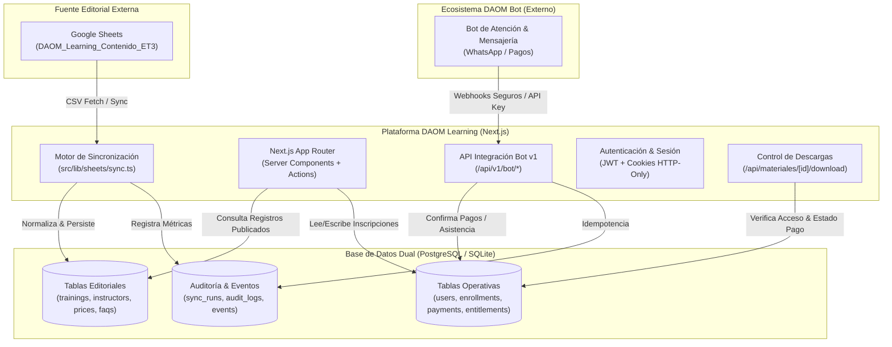

# Arquitectura de Software — DAOM Learning

**Canario del Proyecto:** `DAOM-FORMACION-SHEET-01`  
**Fecha:** Noviembre 2026  
**Versión:** 1.0.0

---

## 1. Visión General de la Arquitectura

DAOM Learning está construido bajo una arquitectura modular y desacoplada que separa estrictamente dos planos de información:
1. **Plano Editorial (Contenido y Oferta):** Administrado exclusivamente a través de **Google Sheets** (`DAOM_Learning_Contenido_ET3`), garantizando que el equipo directivo y docente pueda actualizar programas, docentes, fechas y aranceles sin modificar código ni realizar un nuevo despliegue.
2. **Plano Operativo y Transaccional (Usuarios y Eventos):** Gestionado en **PostgreSQL / Supabase** (con compatibilidad SQLite local), responsable de usuarios, autenticación, inscripciones, auditoría de pagos, descargas de archivos ZIP y eventos de integración con el bot.

---

## 2. Separación de Responsabilidades

| Componente | Responsabilidad Principal | Fuente de Verdad |
|---|---|---|
| **Google Sheets** | Edición de cursos, temarios, precios, docentes y FAQs. | Externa (Planilla) |
| **Motor de Sync** | Normalización, validación tipada y almacenamiento de catálogo. | En servidor Next.js |
| **Base de Datos** | Almacenamiento seguro, relaciones relacionales y control de accesos. | PostgreSQL / SQLite |
| **Web Pública** | Exhibición accesible del catálogo validado y fichas técnicas. | Server Components |
| **Área Privada** | Descarga de ZIP, historial de cursada y visualización de certificados. | Autenticada con JWT |
| **Bot DAOM** | Procesamiento de pagos, atención de mensajes y generación de PDFs. | Externo a la web |

---

## 3. Estrategia de Resiliencia y Fallback de Google Sheets

Para evitar que una caída temporal de la API de Google Sheets o un error de red interrumpa la navegación de los usuarios:
1. **Persistencia Local de Catálogo:** Cada sincronización exitosa almacena el catálogo validado en la base de datos relacional.
2. **Consultas sin Bloqueo:** Las páginas públicas (`/`, `/catalogo`, `/capacitacion/[id]`) consultan directamente las tablas de la base de datos, no la API de Google Sheets en tiempo real.
3. **Mantenimiento del Último Estado Válido:** Si una sincronización falla (por ejemplo, timeout o error 503), el sistema registra el fallo en `sync_runs` pero **no elimina ni corrompe** los datos previamente sincronizados.
4. **Actualizaciones sin Redeploy:** El catálogo se revalida periódicamente (ISR de 60 segundos) o mediante ejecución manual desde el panel `/admin` sin necesidad de recompilar la aplicación.

---

## 4. Control de Acceso a Materiales Complementarios

El acceso al archivo ZIP de material didáctico cumple con una regla estricta:
- **Disponibilidad Inmediata:** Se habilita en el panel del participante en el mismo instante en que se confirma el pago.
- **Validación en Servidor:** El endpoint `/api/materiales/[id]/download` valida:
  1. Que exista una sesión de usuario válida.
  2. Que el usuario esté inscripto en la capacitación vinculada al archivo.
  3. Que el estado de la inscripción sea `confirmada` con pago aprobado.
  4. Que la autorización (`material_entitlements`) no haya sido revocada.
- **Trazabilidad:** Cada descarga registra fecha, IP y contador de descargas en la tabla `audit_logs`.

---

## 5. Diseño y Tokens Visuales

El proyecto implementa la dirección **Modular Analítica** del sistema de diseño oficial de DAOM Weightlifting:
- **Azul Primario:** `#003B8E` (`--daom-blue`), con hover `#002B68` y superficie `#EAF2FF`.
- **Rojo de Acento:** `#FF1E25` (`--daom-red`), con versión accesible `#C8101E` y superficie `#FFF0F1`.
- **Superficie de Aplicación:** `#F8FAFC` (`--daom-neutral-50`) con tarjetas en `#FFFFFF`.
- **Bordes y Sombras:** Tarjetas con radio de `14px`, borde `1px solid #E5E7EB` y sombra sutil.
- **Estados Accesibles:** Los indicadores de estado utilizan siempre la combinación **icono + texto + color**, garantizando cumplimiento con WCAG 2.2 AA.
