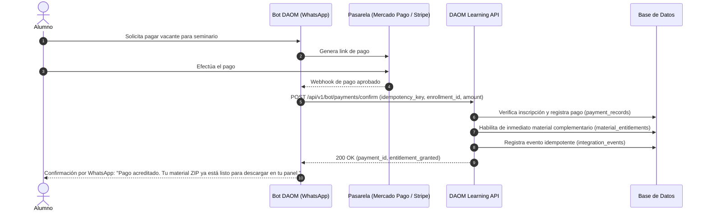

# Contrato de Integración con el Bot (API v1) — DAOM Learning

**Canario del Proyecto:** `DAOM-FORMACION-SHEET-01`  
**Destinatarios:** Equipo de Desarrollo y DevOps del Bot de DAOM Weightlifting.  
**Especificación OpenAPI 3.1:** Disponible en endpoint `GET /api/v1/bot/openapi`.

---

## 1. Principios de Integración

1. **Responsabilidades Desacopladas:**
   - La plataforma **web** gestiona la visualización del catálogo, el registro de inscripciones, la entrega protegida del archivo ZIP de materiales y la exhibición de diplomas.
   - El **bot** gestiona la interacción por mensajería (WhatsApp), la confirmación de cobros con Mercado Pago / Stripe, la generación física de certificados y la notificación de vacantes.
2. **Autenticación entre Servicios:**
   Cada llamada del bot hacia DAOM Learning debe autenticarse mediante:
   - Cabecera HTTP: `x-api-key: <BOT_API_SECRET_KEY>` o `Authorization: Bearer <BOT_API_SECRET_KEY>`.
3. **Idempotencia Estricta:**
   Todas las operaciones de mutación (`POST`) exigen el parámetro obligatorio `idempotency_key`. Si un webhook o reintento de red envía una clave ya procesada, el servidor responde inmediatamente con `200 OK` retornando el resultado previo sin duplicar acciones ni pagos.
4. **Validación de Reglas de Negocio:**
   Los eventos externos son validados contra las restricciones comerciales y pedagógicas del dominio. Una compra en modalidad `on_demand` no puede recibir acreditación de asistencia presencial ni certificado de asistencia (rechazado con HTTP 422).

---

## 2. Flujo de Confirmación de Pago y Habilitación de Materiales



---

## 3. Endpoints del Contrato

### 3.1 Confirmación de Pago
`POST /api/v1/bot/payments/confirm`

Actualiza la inscripción a estado `confirmada`, registra la transacción y **habilita inmediatamente el archivo ZIP de material complementario**.

- **Payload JSON:**
  ```json
  {
    "idempotency_key": "BOT-PAY-20261102-ABC12345",
    "enrollment_id": "ENR-173000000-xyz",
    "external_payment_id": "MP-987654321",
    "provider": "mercadopago",
    "amount": 150000,
    "currency": "ARS",
    "payer_email": "atleta@correo.com",
    "notes": "Pago aprobado por checkout Pro"
  }
  ```
- **Respuesta Exitosa (200 OK):**
  ```json
  {
    "success": true,
    "message": "Pago confirmado exitosamente y material complementario habilitado de inmediato.",
    "payment_id": "PAY-173000000-abc",
    "enrollment_id": "ENR-173000000-xyz",
    "canary": "DAOM-FORMACION-SHEET-01"
  }
  ```

---

### 3.2 Actualización de Estado de Inscripción
`POST /api/v1/bot/enrollments/status`

Permite al bot mover estados de participantes (ej: colocar en lista de espera o cancelar por vencimiento del plazo de 6 horas).

- **Payload JSON:**
  ```json
  {
    "idempotency_key": "BOT-STATUS-20261102-STATUS01",
    "enrollment_id": "ENR-173000000-xyz",
    "status": "en_espera",
    "notes": "Plazo de espera extendido 6 horas"
  }
  ```
- **Valores admitidos para `status`:** `'pendiente_pago'`, `'confirmada'`, `'cancelada'`, `'reembolsada'`, `'en_espera'`.

---

### 3.3 Registro de Asistencia
`POST /api/v1/bot/attendance/record`

Registra la presencia efectiva del participante en una sesión.

- **Payload JSON:**
  ```json
  {
    "idempotency_key": "BOT-ATT-20261102-001",
    "enrollment_id": "ENR-173000000-xyz",
    "user_id": "USR-173000000-abcd",
    "session_date": "2026-11-15",
    "attended": true,
    "modality_attended": "presencial",
    "checked_in_by": "bot_qr_scan",
    "notes": "Ingreso por plataforma 1"
  }
  ```
- **Restricción:** Si la inscripción es `on_demand`, la API rechaza la operación con `HTTP 422 Unprocessable Entity` ya que dicha modalidad no acredita asistencia.

---

### 3.4 Vinculación de Certificados Oficiales
`POST /api/v1/bot/certificates/link`

Permite al bot asociar el PDF emitido de un certificado para que el participante lo visualice y descargue en su perfil.

- **Payload JSON:**
  ```json
  {
    "idempotency_key": "BOT-CERT-20261102-CERT99",
    "enrollment_id": "ENR-173000000-xyz",
    "user_id": "USR-173000000-abcd",
    "certificate_code": "DAOM-SQUATS-2026-0042",
    "title": "Certificado de Asistencia y Aprobación: Seminario de Squats",
    "issue_date": "2026-11-16",
    "pdf_url": "https://storage.daom-weightlifting.com/certificates/daom-squats-0042.pdf",
    "verification_hash": "e3b0c44298fc1c149afbf4c8996fb92427ae41e4649b934ca495991b7852b855"
  }
  ```

---

### 3.5 Solicitud de Cambio de Modalidad
`POST /api/v1/bot/modality-change/request`

Calcula y registra el recargo reglamentario (0% con $\ge$ 7 días; 25% con $<$ 7 días) para que el bot o personal de soporte procese la solicitud.

- **Payload JSON:**
  ```json
  {
    "idempotency_key": "BOT-MOD-20261102-MOD01",
    "enrollment_id": "ENR-173000000-xyz",
    "requested_modality": "streaming",
    "reason": "Imposibilidad de viaje a sede presencial"
  }
  ```
- **Respuesta (200 OK):**
  ```json
  {
    "success": true,
    "enrollment_id": "ENR-173000000-xyz",
    "fee_calculation": {
      "isEligible": true,
      "daysUntilEvent": 4,
      "surchargePercentage": 25,
      "surchargeAmount": 37500,
      "totalWithFee": 187500,
      "reason": "Solicitud realizada a 4 días del evento. Aplica recargo del 25%."
    },
    "canary": "DAOM-FORMACION-SHEET-01"
  }
  ```

---

### 3.6 Consulta de Catálogo Autorizado
`GET /api/v1/bot/trainings/catalog`

Permite al bot consultar en tiempo real las capacitaciones activas, temarios y precios para alimentar sus respuestas automáticas a los usuarios por WhatsApp.
